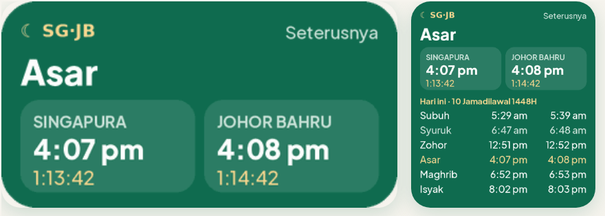
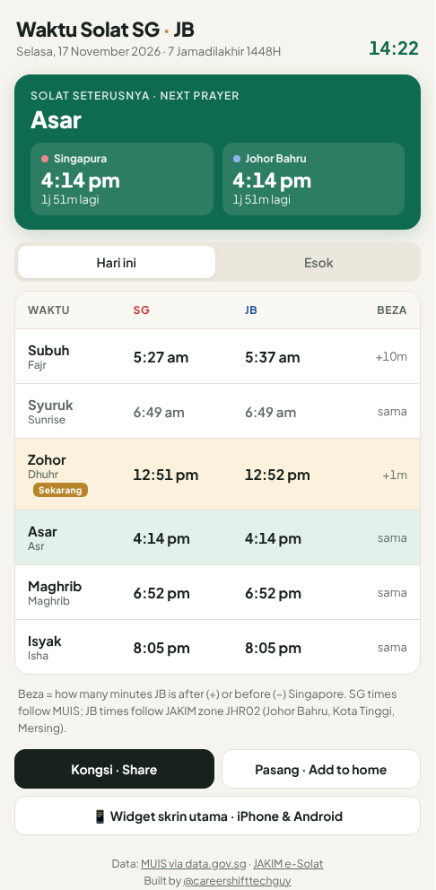

🕌 Track Singapore & Johor Bahru prayer times right on your home screen!

  

📲 [Download link](https://github.com/shiftedtech/solatsgjb/releases/tag/v1.0.0)

How to install on Android:
1. Tap the download link (select "Download anyway" if your browser warns you).
2. Tap the downloaded file. If prompted, allow your browser to "Install unknown apps".
3. Tap "Install". (If Google Play Protect scans it, tap "More details" > "Install anyway").
4. Go to your Home Screen > long press an empty space > Widgets > "Solat SG" to add it!

## Web version

No install needed. Open [solat.remindclient.app](https://solat.remindclient.app) on any phone or computer.

  

